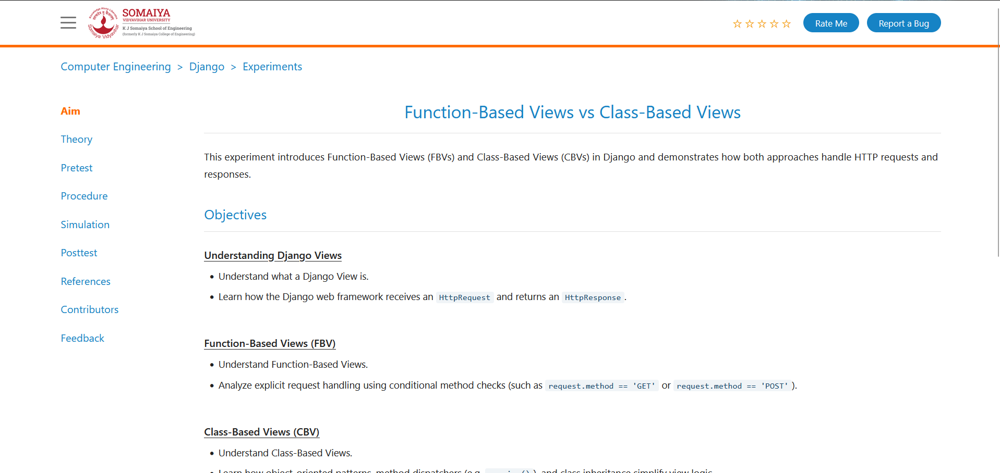
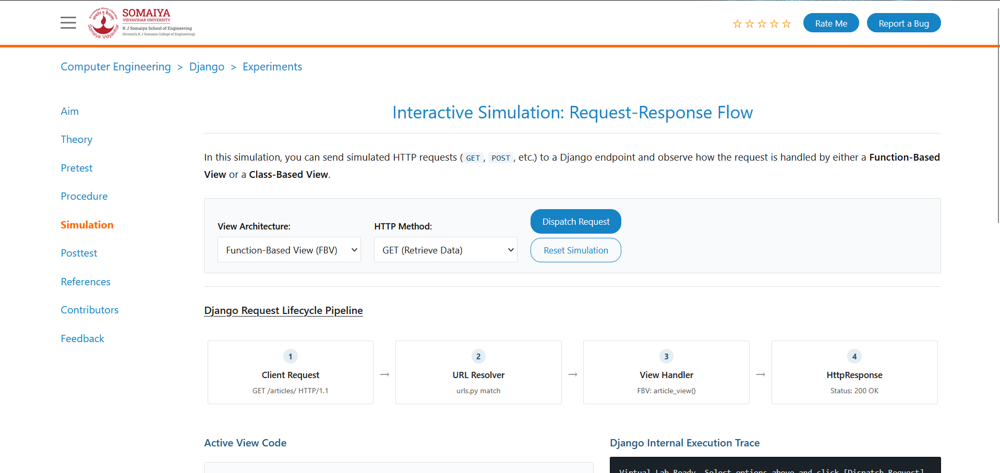

# 🚀 VLab – Virtual Programming Laboratory

<p align="center">
  
  
  
  
  
</p>

<p align="center">
  A web-based Virtual Programming Laboratory designed to make computer engineering experiments accessible, organized, and easier to understand.
</p>

<p align="center">
  <a href="https://vlab-django.vercel.app/"><strong>🌐 Live Demo</strong></a> •
  <a href="https://github.com/yashrajpokle/VLab"><strong>📂 GitHub Repository</strong></a>
</p>

---

## 📌 About the Project

**VLab (Virtual Programming Laboratory)** is a Django-based web application developed to provide students with a centralized platform for accessing computer engineering laboratory experiments and learning resources.

The platform organizes practical learning materials into structured sections, helping students understand experiment concepts, follow procedures, explore simulations, and prepare for practical assessments.

The project focuses on creating an accessible and organized digital learning experience through a clean web interface.

## ✨ Features

- 📚 **Experiment Resources** – Access structured laboratory experiment content.
- 🎯 **Aim and Objectives** – Understand the purpose and expected outcomes of experiments.
- 📖 **Theory** – Learn the fundamental concepts behind each experiment.
- ⚙️ **Prerequisites** – Review the knowledge required before starting.
- 📝 **Procedure** – Follow experiment instructions step by step.
- 💻 **Simulation** – Access the simulation section of experiments.
- 🧠 **Post-Test** – Review and test your understanding.
- 📑 **References** – Explore additional learning resources.
- 👥 **Contributors** – View project contributor information.
- 💬 **Feedback** – Access the feedback section.

## 🛠️ Tech Stack

| Technology | Purpose |
|---|---|
| Python | Backend programming |
| Django | Web framework |
| HTML5 | Page structure |
| CSS3 | Styling and layout |
| JavaScript | Frontend interactions |
| SQLite | Local database |
| Git & GitHub | Version control |
| Vercel | Deployment |

## 🌐 Live Deployment

The project is deployed using Vercel.

**Live Website:** https://vlab-django.vercel.app/

## 📸 Screenshots

Add screenshots of your actual application in a `screenshots/` folder and use the following paths.

### Homepage



### Experiment Interface




> Note: Add the corresponding screenshot files to the repository to display these images.

## 📁 Project Structure

```text
VLab/
│
├── django_vlab/
│   ├── __init__.py
│   ├── asgi.py
│   ├── settings.py
│   ├── urls.py
│   └── wsgi.py
│
├── vlab/
│   ├── migrations/
│   ├── static/
│   │   └── vlab/
│   │       ├── css/
│   │       ├── images/
│   │       └── js/
│   │
│   ├── templates/
│   │   └── vlab/
│   │
│   ├── admin.py
│   ├── apps.py
│   ├── models.py
│   ├── tests.py
│   ├── urls.py
│   └── views.py
│
├── .gitignore
├── .python-version
├── manage.py
├── requirements.txt
└── README.md
```

## ⚙️ Installation and Setup

Follow these steps to run the project locally.

### 1. Clone the repository

```bash
git clone https://github.com/yashrajpokle/VLab.git
```

### 2. Navigate to the project directory

```bash
cd VLab
```

### 3. Create a virtual environment

```bash
python -m venv venv
```

### 4. Activate the virtual environment

**Windows PowerShell:**

```powershell
.\venv\Scripts\Activate.ps1
```

**Linux / macOS:**

```bash
source venv/bin/activate
```

### 5. Install dependencies

```bash
pip install -r requirements.txt
```

### 6. Apply database migrations

```bash
python manage.py migrate
```

### 7. Start the development server

```bash
python manage.py runserver
```

### 8. Open the application

Visit:

```text
http://127.0.0.1:8000/
```

## 🔐 Environment Configuration

The project uses environment variables for important Django settings.

| Variable | Description |
|---|---|
| `DJANGO_SECRET_KEY` | Django secret key |
| `DJANGO_DEBUG` | Enables or disables debug mode |

For production deployment:

- Set a secure `DJANGO_SECRET_KEY` in Vercel Environment Variables.
- Keep `DJANGO_DEBUG` set to `False`.
- Never commit private credentials or secret keys to GitHub.

## 🚀 Deployment

This project is deployed on **Vercel**.

General deployment workflow:

1. Push the latest project changes to GitHub.
2. Connect the GitHub repository to Vercel.
3. Configure the Django framework settings.
4. Set the required environment variables.
5. Deploy the application.

**Production URL:** https://vlab-django.vercel.app/

## 🔮 Future Improvements

Some possible improvements for future development:

- Interactive coding environments.
- More laboratory experiments and subjects.
- Student authentication and personalized dashboards.
- Experiment progress tracking.
- Online assessment and automated evaluation.
- Improved mobile responsiveness.
- Persistent cloud database integration.
- Enhanced simulation capabilities.

## 🤝 Contributing

Contributions and suggestions are welcome!

If you would like to improve the project:

1. Fork the repository.
2. Create a new branch.
3. Make your changes.
4. Commit your changes.
5. Submit a Pull Request.

## 👨‍💻 Authors

**Ramesh Patel**
**Yashraj Pokle**

Computer Engineering Student

- GitHub: [@yashrajpokle](https://github.com/yashrajpokle)
- Project: [VLab](https://github.com/yashrajpokle/VLab)
- Live Website: [VLab – Virtual Programming Laboratory](https://vlab-django-1b3zehcvc-yashrajpokle.vercel.app)

---

<p align="center">
  <strong>Built with ❤️ using Django and Python.</strong>
</p>

<p align="center">
  If you find this project useful, consider giving it a ⭐ on GitHub!
</p>
